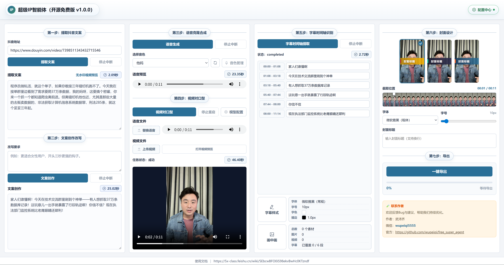
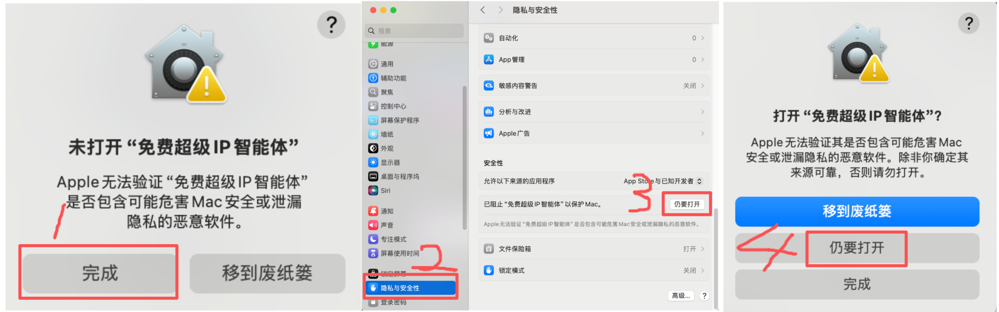
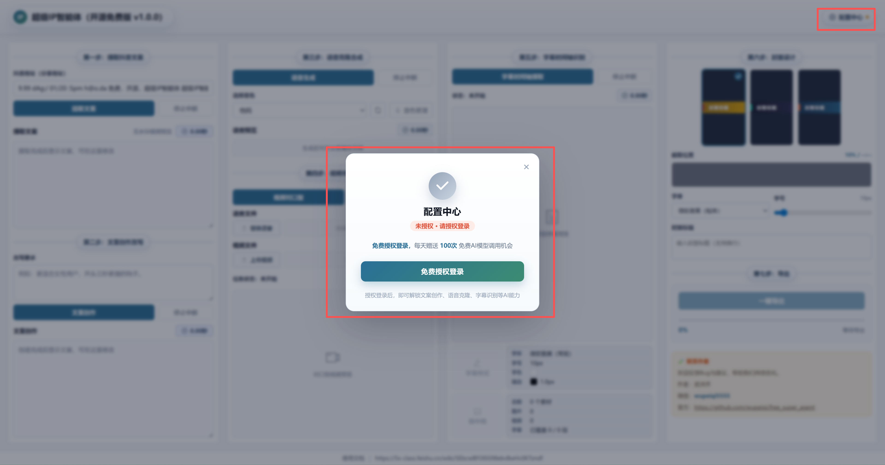
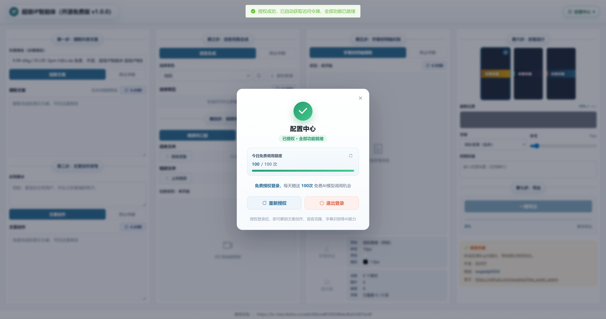
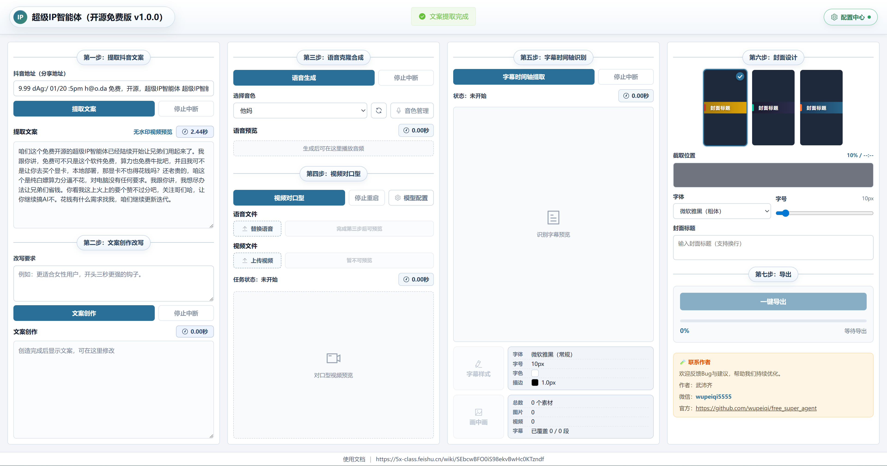
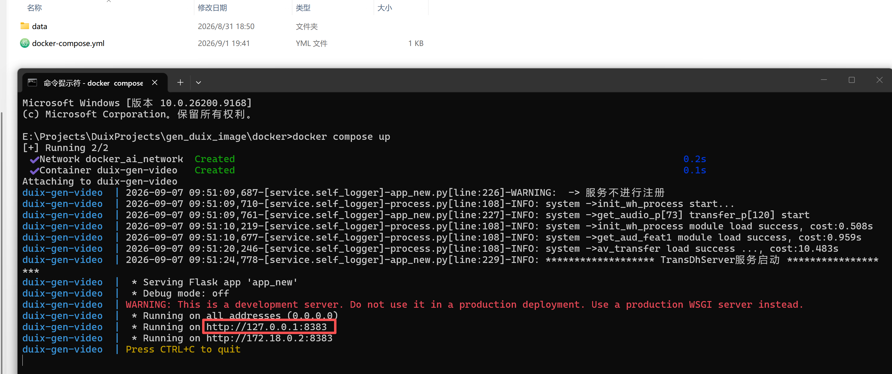
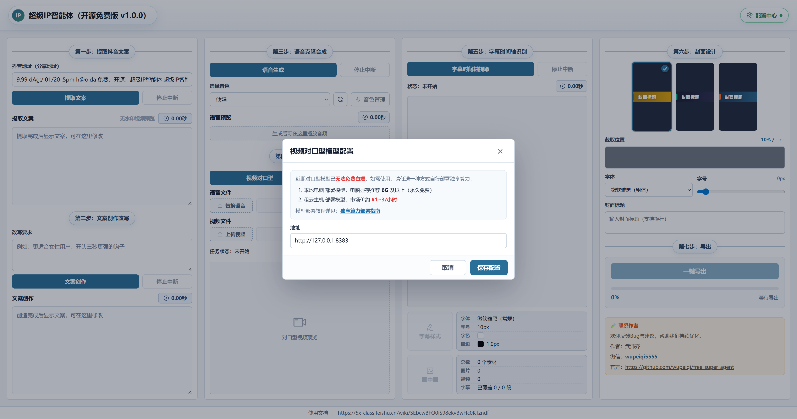

# 超级IP智能体（开源免费版）

- 作者：武沛齐
- 微信：wupeiqi5555



一个把抖音爆款视频改写成自己成品视频的桌面工具。

粘一条抖音链接进来，走完文案改写、声音克隆、视频对口型、字幕、封面、烧制导出，产出可以直接发布的竖屏视频。


## 一、它能做什么


| 步骤               | 做什么                                                   | 算力消耗     |
| ------------------ | -------------------------------------------------------- | ------------ |
| 一、提取抖音文案   | 粘贴抖音链接，自动下载无水印视频并把口播内容转成文字     | **免费**     |
| 二、文案创作改写   | 按你的要求把原文案改写成自己的脚本                       | **免费**     |
| 三、语音克隆合成   | 录一段或上传一段音色样本，用你的声音把文案读出来         | **免费**     |
| 四、视频对口型     | 把合成的语音和一段人物视频合成口型匹配的视频             | 本地模型部署 |
| 五、字幕时间轴识别 | 自动识别出带时间轴的字幕，可以逐条改字、调字体和描边样式 | **免费**     |
| 六、封面设计       | 从视频里抽一帧做底图，填标题、选排版风格，生成封面图     | **免费**     |
| 七、导出           | 把字幕烧进画面，叠上画中画，封面作首帧，输出成品         | **免费**     |


## 二、下载安装

到本仓库的 [Releases](../../releases) 页面下载最新版本：

| 文件                              | 适用系统                                |
| --------------------------------- | --------------------------------------- |
| `SuperAgent-vX.Y.Z-win-x64.exe`   | Windows 10/11 64 位，免安装，双击就能用 |
| `SuperAgent-vX.Y.Z-mac-arm64.dmg` | macOS，M 系列芯片                       |

注意：**不支持** Intel 芯片的 Mac


**MacOS**：安装包未做代码签名与公证，首次打开会被拦下。

第1步：到「系统设置 → 隐私与安全性」页面底部点「仍要打开」



第2步：终端执行命令

```
xattr -dr com.apple.quarantine "/Applications/免费超级IP智能体.app"
```

根据引导输入电脑密码授权可以打开项目即可。


## 三、快速使用

打开项目后，在右上角打开配置中心，按照引导进行授权登录（新用户注册）。

授权登录成功后，就可以**免费白嫖算力**了。。。









## 四、AI对口型（本地模型部署）

| 步骤               | 做什么                                                   | 算力消耗     |
| ------------------ | -------------------------------------------------------- | ------------ |
| 一、提取抖音文案   | 粘贴抖音链接，自动下载无水印视频并把口播内容转成文字     | **免费**     |
| 二、文案创作改写   | 按你的要求把原文案改写成自己的脚本                       | **免费**     |
| 三、语音克隆合成   | 录一段或上传一段音色样本，用你的声音把文案读出来         | **免费**     |
| 四、视频对口型     | 把合成的语音和一段人物视频合成口型匹配的视频             | 本地模型部署 |
| 五、字幕时间轴识别 | 自动识别出带时间轴的字幕，可以逐条改字、调字体和描边样式 | **免费**     |
| 六、封面设计       | 从视频里抽一帧做底图，填标题、选排版风格，生成封面图     | **免费**     |
| 七、导出           | 把字幕烧进画面，叠上画中画，封面作首帧，输出成品         | **免费**     |


2026年7月份之前，对口型算力也可以白嫖，暂时未找到白嫖算力，兄弟们只能自己部署调用了。具体部署步骤：

- 第1步：**本地有显卡的电脑** 或  **租有显卡的云主机**  （推荐显存 **6G+**）

- 第2步：安装Docker

- 第3步：创建 docker-compose.yml 文件并写入内容

  ```yaml
  networks:
      ai_network:
          driver: bridge
  services:
      duix-gen-video:
          image: wupeiqi/duix
          container_name: duix-gen-video
          restart: always
          runtime: nvidia
          privileged: true
          volumes:
              - ./data:/code/data
          environment:
              - PYTORCH_CUDA_ALLOC_CONF=max_split_size_mb:512
          deploy:
              resources:
                  reservations:
                      devices:
                          - capabilities: [gpu]
          shm_size: '6g'
          ports:
              - '8383:8383'
          networks:
              - ai_network
  ```

- 第4步：启动对口型服务

  ```
  docker compose up
  ```

  

获取本机算力地址，例如：  http://127.0.0.1:8383    后续要填入到对口型的模型配置中。




## 五、常见问题

**一直提示要先去配置中心授权**

- 模力方舟的登录状态过期了，重新点一次配置中心的授权即可。访问令牌本身很久才失效，但登录态失效会影响上传音色样本。

**Windows 提示找不到 ffmpeg.exe**

- 杀毒软件把它拦了。把程序所在的文件夹加进杀毒软件的白名单或排除项，然后重开程序。

**macOS 连不上局域网里的对口型服务**

- macOS 15 开始，访问局域网需要单独授权。首次连接时按弹窗允许，或者去「系统设置 → 隐私与安全性 → 本地网络」把本程序打开。填 `127.0.0.1` 连本机服务不受这个限制。

**对口型提交后报服务器忙碌**

- 算力服务一次只能跑一个任务，等当前任务结束再提交。

**抖音链接提取失败**

- 先确认链接还能正常打开。抖音的接口时常调整，如果链接没问题但一直失败，可以到 Issues 反馈。


## 许可说明

程序内置的 `ffmpeg-static` 采用 GPL-3.0 许可，分发时需遵守相应条款。`src/assets/fonts/` 下的字体请自行确认商用授权。

